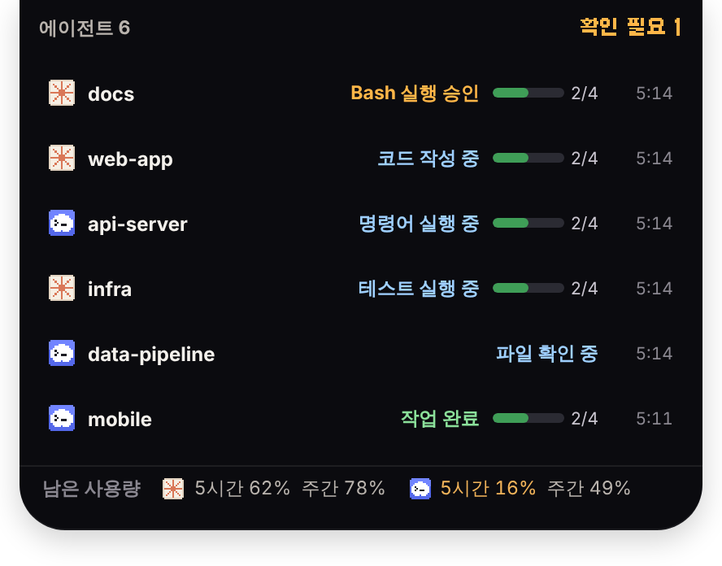

# Agent Room

AI 코딩 에이전트(Claude Code, OpenAI Codex CLI)가 지금 무엇을 하는지 **작은 픽셀 아트 사무실**로 보여주는 macOS 앱입니다.
세션마다 펫이 한 마리씩 자기 책상에 앉아 일하고, 승인이나 답변이 필요하면 앞으로 나와 알려줍니다.


> 모니터링에 쓰는 **추가 LLM 토큰은 0**입니다. 에이전트의 공식 Hook과 로컬 로그만 읽고, 네트워크 요청은 Claude 계정 사용량 확인과 업데이트 확인뿐입니다(둘 다 설정에서 끌 수 있음).

## 주요 기능

- **사무실 화면**: 세션마다 펫 한 마리(최대 6). 하는 일에 따라 그림판에 쓰고, 책장에서 읽고, 나무 장치를 돌리고, 승인을 기다리면 콩콩 뛰고, 끝나면 점프합니다. 일이 없으면 커피를 마시거나 돌아다닙니다.
- **여러 경로의 세션**: Hook이 닿지 않는 세션(앱보다 먼저 시작한 세션, Claude·Codex 데스크톱 앱, Codex 예약 작업이나 `codex exec`)도 에이전트의 세션 로그가 쓰이는 시각으로 찾아서 작업 중·쉬는 중을 보여 줍니다.
- **현황판**: 내 차례·작업 중·완료 수, 내가 할 일(승인·입력·오류), 에이전트별 진행(n/m)과 경과 시간.
- **남은 사용량**: Claude·Codex의 5시간·주간 남은 %와 초기화까지 남은 시간. 10% 이하가 되면 알림을 보냅니다.
- **메뉴 막대 팝오버**와 화면 맨 위 가운데의 **다이나믹 아일랜드**.
- **꾸미기**: 색 테마 5종, 방 조명, 펫 바꾸기와 내 PNG 펫, 이벤트별 효과음.

<p align="center"></p>

## 설치

### 앱 받기 (macOS, Apple Silicon)

```bash
npx github:kgyujin/agent-room
```

최신 릴리스를 받아 `/Applications`에 넣고 바로 실행합니다. Node.js 18 이상과 git이 필요합니다. 이렇게 받으면 "손상되었기 때문에 열 수 없습니다" 경고가 뜨지 않습니다.

한 번 설치하면 그다음부터는 앱 안에서 업데이트됩니다. 실행할 때와 6시간마다 새 버전을 확인하고, 새 버전이 있으면 위쪽에 **업데이트** 버튼이 뜹니다.

| 하려는 일 | 명령 |
| --- | --- |
| 설치·최신 버전으로 업데이트 | `npx github:kgyujin/agent-room` |
| 앱과 에이전트 Hook 제거 | `npx github:kgyujin/agent-room uninstall` |
| 도움말 | `npx github:kgyujin/agent-room --help` |

<details>
<summary>직접 받아 설치하기</summary>

[Releases](https://github.com/kgyujin/agent-room/releases)에서 `.dmg`를 받습니다. 앱은 Apple 공증을 받지 않았습니다. 처음 열 때는 Finder에서 우클릭 → 열기를 누르세요. 그래도 열리지 않으면 아래를 실행합니다.

```bash
xattr -dr com.apple.quarantine "/Applications/Agent Room.app"
```

</details>

### 에이전트 연결

처음 실행하면 나오는 안내 카드나 **설정 → 에이전트 연동**에서 **연결하기**를 누릅니다.

| 에이전트 | 바뀌는 파일 | 참고 |
|---|---|---|
| Claude Code | `~/.claude/settings.json`의 `hooks`, `statusLine` (`CLAUDE_CONFIG_DIR`을 따름) | 남은 사용량은 Pro·Max 요금제만 나옵니다 |
| Codex | `~/.codex/hooks.json` (`CODEX_HOME`을 따름) | Codex에서 `/hooks`를 열어 한 번 승인해야 실행됩니다 |

- 바꾸기 전에 원본을 `~/.agent-room/backups/`에 백업합니다. 기존 Hook과 설정 키 순서는 그대로 둡니다.
- 쓰던 Claude 상태줄 명령은 그대로 실행되고 출력도 같습니다. Agent Room이 감싸서 숫자만 읽습니다.
- 연결한 뒤 새로 시작한 세션부터 방에 나타납니다.

### 제거

- **한 번에**: `npx github:kgyujin/agent-room uninstall`이 에이전트 설정에서 Agent Room Hook을 빼고 앱을 지웁니다. `~/.agent-room`의 백업은 남깁니다.
- **설정 → 고급 → 모든 Hook 제거**: 에이전트 설정에서 Agent Room 항목만 빼고, 상태줄도 원래대로 되돌립니다.
- 앱 없이 제거하려면 `~/.agent-room/bin/agent-room-hook --uninstall`을 실행합니다.
- 원래 설정으로 되돌리려면 **설정 → 고급 → 가장 최근 백업으로 복원**을 누릅니다. 현재 파일도 먼저 백업합니다.
- Hook을 남긴 채 앱만 지워도 에이전트는 정상 동작합니다. Hook은 앱이 없으면 곧바로 조용히 끝납니다.

## 사용법

- **창 닫기**를 하면 앱이 메뉴 막대로 숨습니다. 메뉴 막대 아이콘을 왼쪽 클릭하면 현황 팝오버가 열리고, 오른쪽 클릭하면 메뉴가 열립니다.
- **다이나믹 아일랜드**: 왼쪽에는 일하는 에이전트가, 오른쪽에는 확인할 일 수(`! 1`)나 작업 중 수가 보입니다. 마우스를 올리면(설정에서 클릭으로 바꿀 수 있음) 펼쳐지고, 줄을 누르면 그 세션이 열립니다. 노치가 있는 맥에서는 노치 크기에 맞춰집니다.
- **오른쪽 패널**: 현황, 타임라인, 작업 목록, 세션 정보 탭이 있습니다. "약 N분 남음"은 끝난 단계의 평균 시간으로 낸 추정치이고, 단계가 하나라도 끝나야 보입니다.
- **위쪽 탭**: 세션을 고릅니다. "자동"은 가장 주의가 필요한 세션(승인 대기 > 오류 > 작업 중)을 보여줍니다. 펫이나 이름표를 눌러도 됩니다.
- **오른쪽 위 버튼**: 패널 접기, 사무실만 보기, 룸만 띄우기(테두리 없이 방만 바탕화면에 띄움, 어디를 잡아도 창이 옮겨지고 펫을 두 번 누르면 상세가 열림), 항상 위, 전체 화면, 소리, 설정.
- **방 조작**: 스크롤하면 확대·축소되고, 끌면 이동합니다. 빈 곳을 두 번 누르면 원래 크기로 돌아갑니다.
- **창밖 하늘**: 컴퓨터 시계에 따라 아침·낮·노을·밤으로 바뀝니다.

| 설정 탭 | 내용 |
|---|---|
| 꾸미기 | 색 테마, 방 조명, 방 바깥 배경, 글꼴, 펫 이름표, 펫 활동량(차분·보통·활발), 아일랜드 펼치기 방식, 위쪽 탭·남은 사용량·아래쪽 상태 카드·다이나믹 아일랜드 켜고 끄기 |
| 캐릭터 | 에이전트별 펫, 펫 색, **PNG 추가**(`~/.agent-room/characters/`에 복사, 1칸 = 1px로 줄이고 단색 배경은 투명하게, 큰 그림은 방 크기에 맞게 줄이고 걷는 동작을 붙임) |
| 알림·소리 | 효과음, 배경 음악, 완료·오류·승인·남은 사용량 알림, 항상 위, 로그인 시 자동 실행, 이벤트별 소리 파일(mp3·wav·ogg·m4a, 2MB 이하) |
| 에이전트 연동 | 연결하기 / 다시 연결 |
| 고급 | 데모 모드, 응답 없음으로 표시할 시간, 백업 복원, 모든 Hook 제거 |

**데모 모드**는 가상 이벤트를 재생합니다. 데모 세션에는 `DEMO` 표시와 보라색 배너가 붙고, 실제 세션과 섞이지 않으며 알림도 보내지 않습니다.

## 토큰 0, 개인정보 최소 수집

- Hook은 **stdout에 아무것도 쓰지 않고** 항상 exit 0으로 끝납니다. 그래서 에이전트의 컨텍스트, 동작, 권한 흐름에 끼어들지 않습니다.
- 프롬프트, 응답, 파일 내용, 명령 출력은 Hook 안에서 버립니다. 명령어도 `*_TOKEN=`, `Bearer …`, `sk-…` 같은 값을 가린 뒤 잘라서 보냅니다.
- 앱에는 HTTP 클라이언트가 없고, WebView CSP가 외부 연결을 막습니다. 업데이트 확인은 GitHub Releases에, Claude 계정 사용량은 `api.anthropic.com`에만 접속합니다.
- 이벤트는 메모리에만 둡니다(세션당 최근 300개). 디스크에는 설정, 에이전트 설정 백업, 보관한 상태줄 명령만 저장합니다.
- `~/.agent-room`은 본인만 열 수 있고(0700), 백업과 상태줄 사본은 본인만 읽을 수 있습니다(0600). 에이전트 설정의 `env`에 API 키가 있을 수 있어서입니다. 소켓도 본인 전용입니다.
- Hook이 없는 세션은 `~/.claude/projects`, `~/.codex/sessions`의 로그 파일 이름과 수정 시각, 파일 앞부분의 `cwd` 값만 봅니다. 대화 내용은 해석하거나 저장하지 않습니다.
- 남은 사용량은 에이전트가 이미 내놓는 숫자만 읽습니다. Claude는 상태줄 입력의 `rate_limits`, Codex는 rollout 로그의 `rate_limits`입니다.
- 상태줄이 없는 Claude 세션(데스크톱 앱, VS Code)을 위해 "Claude 계정에서 받아오기"가 켜져 있으면 Claude Code가 키체인에 둔 로그인을 `/usr/bin/security`로 읽어 Anthropic 사용량 API(`/api/oauth/usage`)에 5분에 한 번 묻습니다. 토큰은 메모리에서 한 번 쓰고 버리며 저장·갱신하지 않고, `curl`에 인자가 아닌 표준 입력으로 넘깁니다. LLM 호출이 아니라 토큰을 쓰지 않습니다.

## 동작 방식

```
Claude Code / Codex ──(공식 Hook, stdin JSON)──▶ agent-room-hook ──(로컬 소켓)──▶ Agent Room 앱
                                                 · 허용한 필드만 남김             · 어댑터 → 공통 이벤트
                                                 · stdout 없음, exit 0           · 세션 상태 머신
                                                 · 앱이 없으면 0.3초 안에 종료      · 캔버스 렌더러, 팝오버, 아일랜드, 알림
```

| 구성 | 역할 |
|---|---|
| `crates/core` | 공통 이벤트 모델, 에이전트 어댑터(`adapters/`), 민감정보 필터(`sanitize.rs`), 세션 상태 머신(`session.rs`), Hook 설치·제거(`install.rs`), 남은 사용량(`limits.rs`), 소켓 서버(`runtime.rs`) |
| `crates/hook` | `agent-room-hook` 바이너리. 에이전트 설정에 등록되는 Hook 명령이자 Claude 상태줄 래퍼(`statusline`) |
| `app/src-tauri` | Tauri 2 셸: 소켓 서버 실행, 메뉴 막대, 팝오버·아일랜드 창, 알림, 데모 모드, 설정 저장 |
| `app/src` | React + TypeScript UI와 Canvas 2D 픽셀 렌더러(`game/`) |
| `tools/art` | 모든 픽셀 아트를 코드로 생성하는 Python(PIL) 스크립트. AI 이미지 생성은 쓰지 않음 |

Canvas 2D로 원본 해상도 버퍼에 그린 뒤 정수 배율로 키웁니다. 그래서 도트 1칸이 항상 한 가지 색입니다. 렌더링은 12fps이고, 창이 포커스를 잃으면 6fps로 낮추며, 숨기면 멈춥니다. 팝오버와 아일랜드 창은 필요할 때만 만듭니다.

### 상태 매핑

| 상태 | Claude Code 근거 | Codex 근거 |
|---|---|---|
| 쉬는 중 | `SessionStart`, 중단 후 | `SessionStart`, `Interrupt` |
| 계획 | `TodoWrite`·Task 도구, `PreCompact` | `update_plan`, `PreCompact` |
| 읽기 | `Read`, `Grep`, `Glob`, `WebFetch` 등 | `read_file`, `list_dir`, `web_search` 등 |
| 코드 작성 | `Edit`, `Write`, `MultiEdit` (파일명만) | `apply_patch` (패치 헤더의 파일명만) |
| 명령 실행 | `Bash`, MCP, 하위 에이전트 | 셸 명령, MCP |
| 테스트 | 테스트 러너 명령(`npm test`, `pytest`, `cargo test` 등) | 같음 |
| 승인·답변 필요 | `PermissionRequest`, `Notification`, `AskUserQuestion` | `PermissionRequest` |
| 완료 | `Stop` | `Stop` |
| 오류 | `StopFailure`, `PostToolUseFailure` | `PostModelRequest`(failed) |
| 연결 끊김 | `SessionEnd`, 또는 에이전트 프로세스가 사라짐 | 같음 |

추측하지 않는 것들:

- **진행률**은 에이전트가 직접 만든 작업 목록이 있을 때만 n/m으로 보여줍니다.
- 일정 시간(기본 3분) 동안 이벤트가 없으면 상태를 확정하지 않고 "응답 없음"으로 바꿉니다.
- 공식 Hook에는 "승인됨" 이벤트가 없습니다. 그래서 승인한 뒤 도구가 끝날 때까지 "승인 필요"가 남아 있을 수 있습니다.
- Codex는 실제 설치 환경에서는 아직 확인하지 못했고, 문서 기준 어댑터와 단위 테스트로만 확인했습니다.

## 개발

필요한 것: Rust stable, Node 20 이상, Xcode Command Line Tools

```sh
cd app
npm install
npm run app:dev      # 개발 실행 (Hook 사이드카 빌드 포함)
npm run app:build    # .app / .dmg 생성
```

- **브라우저 미리보기**: `npm run dev`를 실행한 뒤 `http://localhost:1420/?preview=multi`를 엽니다.
  - 상태: `none`, `editing`, `reading`, `planning`, `running`, `testing`, `testfail`, `waiting`, `completed`, `stale`, `multi`
  - 옵션: `&theme=night`, `&view=tray`, `&view=island`
- **테스트**: `cargo test -p agent-room-core`
- **이벤트 확인**: `cargo run -p agent-room-core --example monitor`를 실행하면 앱 대신 터미널에 이벤트를 출력합니다.
- **새 에이전트 추가**: `crates/core/src/adapters/`에 어댑터를 추가하고, `install.rs`의 `Target`에 설정 경로를 등록합니다.
- **릴리스**: main에 코드가 들어갈 때마다 `release` 워크플로가 자동으로 새 버전(`tauri.conf.json`의 앞 두 자리 + 실행 번호, 예: `0.3.12`)을 만들어 서명된 업데이트를 올립니다. README와 `docs/`만 바뀐 경우에는 건너뜁니다. 앞 두 자리를 올리려면 `version`만 바꾸면 됩니다.
  - 저장소 Secret `TAURI_SIGNING_PRIVATE_KEY`가 필요합니다.
  - 그 키의 공개키가 `plugins.updater.pubkey`와 같아야 합니다.

## 라이선스

MIT. UI 글꼴은 [갈무리(Galmuri)](https://github.com/quiple/galmuri)이며 SIL Open Font License 1.1을 따릅니다.
