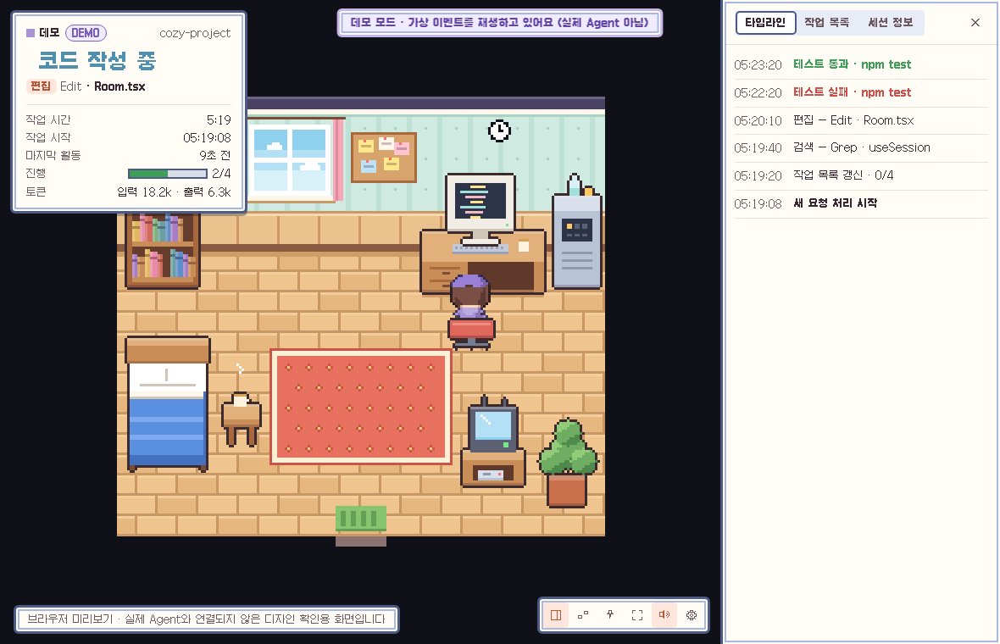

# Agent Room

AI 코딩 Agent(Claude Code, OpenAI Codex CLI)가 지금 무엇을 하고 있는지 **하늘에 떠 있는 작은 픽셀 아트 방**에서 보여주는 macOS 데스크톱 앱입니다.
Agent가 코드를 쓰면 캐릭터가 책상에서 타이핑하고, 파일을 읽으면 책장에서 책을 꺼내고, 테스트를 돌리면 작업대 장비를 조작합니다. 승인이 필요하면 앞으로 나와 손을 흔듭니다.



> 모니터링 때문에 쓰는 **추가 LLM 토큰은 0**입니다. 이 앱은 Agent의 공식 Hook과 로컬 로그만 읽고, 규칙으로 상태를 바꿉니다. 네트워크 요청도 하지 않습니다.

## 어떻게 동작하나

```
Claude Code / Codex ──(공식 Hook: stdin JSON)──▶ agent-room-hook ──(로컬 소켓, 한 줄 JSON)──▶ Agent Room 앱
                                                  │  · 허용 목록 필드만 남김                     │  · 어댑터 → 공통 이벤트
                                                  │  · stdout 출력 없음, 항상 exit 0             │  · 세션 상태 머신
                                                  └  · 앱이 꺼져 있으면 0.3초 안에 조용히 종료      └  · 캔버스 렌더러 / 트레이 / 알림
```

| 구성 | 위치 | 역할 |
|---|---|---|
| `crates/core` | Rust 라이브러리 | 공통 이벤트 모델, Agent 어댑터(`adapters/claude.rs`, `adapters/codex.rs`), 민감정보 필터(`sanitize.rs`), 세션 상태 머신(`session.rs`), Hook 설치/제거(`install.rs`), 남은 사용량 리더(`limits.rs`), 소켓 서버(`runtime.rs`) |
| `crates/hook` | `agent-room-hook` 바이너리 | Agent 설정에 등록되는 Hook 명령. 정리된 이벤트를 `~/.agent-room/run/agent-room.sock` 으로 전달 |
| `app/src-tauri` | Tauri 2 셸 | IPC 서버 실행, 메뉴 막대(트레이) 상태, 시스템 알림, 데모 모드, 설정 저장 |
| `app/src` | React + TypeScript | Canvas 2D 픽셀 렌더러(`game/`), HUD·타임라인·설정 UI(`ui/`) |
| `tools/art` | Python(PIL) | 모든 픽셀 아트를 코드로 생성 (`atlas.png`, 아이콘). AI 이미지 생성 없음 |

### 왜 PixiJS 대신 Canvas 2D인가
장면이 작고(360×250 원본 픽셀) 스프라이트가 수십 개뿐이라, WebGL 렌더러 없이 원본 해상도 버퍼에 그린 뒤 정수 배율로 한 번 확대하는 방식이 가장 가볍습니다. 의존성이 없고 메모리도 작습니다(JS 힙 약 8MB). 12fps로 그리고, 창이 포커스를 잃으면 6fps, 숨겨지거나 최소화되면 렌더링을 멈춥니다.

## 상태 매핑 (실제 이벤트 → 공통 상태 → 캐릭터)

| 공통 상태 | Claude Code 근거 | Codex 근거 | 캐릭터 |
|---|---|---|---|
| idle | `SessionStart`, 중단 후 | `SessionStart`, `Interrupt` | 소파에서 차·독서, 창밖 보기, 오래 쉬면 낮잠 (변형 무작위) |
| starting | `UserPromptSubmit` | `UserPromptSubmit` | 책상으로 이동해 컴퓨터를 켬 |
| planning | `TodoWrite`/`Task*`/플랜 모드 도구, 도구 사이 대기, `PreCompact` | `update_plan`, `PreCompact` | 코르크 보드 메모 보기 / 책상에서 생각 |
| reading | `Read`, `Grep`, `Glob`, `WebFetch`… | `read_file`, `list_dir`, `web_search`… | 책장에서 책 꺼내 읽기 |
| editing | `Edit`, `Write`, `MultiEdit`… (파일명 표시) | `apply_patch` (패치 헤더의 파일명만) | 책상 타이핑, 모니터에 코드 |
| running | `Bash`(테스트 아님), MCP, 서브에이전트 | 셸 명령, MCP | 작업대 장비 조작 |
| testing | `Bash` 명령이 테스트 러너일 때 (`npm test`, `pytest`, `cargo test` 등 고정 규칙) | 동일 | 테스트 장비 + 결과 표시 (성공 시 환호, 실패 시 당황) |
| waiting | `PermissionRequest`, `Notification`(permission/idle/elicitation), `AskUserQuestion` | `PermissionRequest` | 앞으로 나와 손 흔들기 + 느낌표/물음표 |
| completed | `Stop` | `Stop` | 기지개·환호 후 휴식으로 전환 |
| error | `StopFailure`, `PostToolUseFailure` | `PostModelRequest`(status=failed) | 당황 + 땀방울, 패널에 오류 메시지 |
| disconnected | `SessionEnd`, 또는 Agent 프로세스 소멸 | 동일 | 소파에서 잠듦, "연결 끊김" 표시 |

추측하지 않는 것들:
* **진행률**은 Agent가 직접 만든 작업 목록(Claude `TodoWrite`/Task 도구, Codex `update_plan`)이 있을 때만 퍼센트로 보여줍니다. 없으면 "진행 중"과 경과 시간만 보여줍니다.
* Codex는 도구 실패 이벤트가 없어서, 종료 코드가 명시되지 않으면 테스트 결과를 "결과 미제공"으로 둡니다.
* 활동 중 상태에서 일정 시간(기본 3분, 설정 가능) 동안 이벤트가 없으면 상태를 확정하지 않고 "응답 없음"으로 바꿉니다. 캐릭터도 멈추고 흐리게 보입니다.
* 앱이 세션 도중에 켜졌다면 시작 시각을 "앱이 처음 관찰한 시각"으로 표시합니다.
* 알려진 한계: 공식 Hook에는 "승인됨" 이벤트가 없습니다. 그래서 승인 후 도구가 끝날 때까지는 "승인 필요"가 남아 있을 수 있습니다.

## 추가 토큰 0, 민감정보 최소 수집

* Hook 바이너리는 **stdout에 아무것도 쓰지 않습니다.** Claude Code는 `SessionStart`/`UserPromptSubmit`의 stdout을, Codex는 `SessionStart`/`UserPromptSubmit`/`SubagentStart`의 stdout을 모델 컨텍스트에 넣습니다. 출력이 없으니 컨텍스트에 추가되는 것도 없습니다.
* 항상 exit 0으로 끝나고, 결정 JSON도 출력하지 않습니다. 그래서 Agent 동작이나 권한 흐름을 바꾸지 않습니다.
* 앱과 core 크레이트에는 HTTP 클라이언트가 없습니다 (`cargo tree`에 reqwest/hyper/ureq 없음). WebView CSP도 `connect-src ipc:`로 막혀 있습니다.
* 프롬프트, Agent 응답, 파일 내용, 명령 출력은 Hook 프로세스 안에서 버리고 앱으로 보내지 않습니다. 명령어는 `*_TOKEN=`, `Bearer …`, `sk-…` 같은 값을 가린 뒤 잘라서 보냅니다.
* 이벤트는 메모리에만 있습니다(세션당 최근 300개). 디스크에 저장하는 것은 설정 파일과 Agent 설정 백업뿐입니다.
* 남은 사용량(5시간·주간 한도)은 Agent가 이미 내놓는 숫자만 읽습니다. Claude Code는 상태줄 명령에 넘겨주는 `rate_limits`(Pro·Max 요금제), Codex는 rollout 로그의 `rate_limits`입니다.
* Claude의 상태줄은 `agent-room-hook statusline`이 감쌉니다. 쓰던 상태줄 명령은 `~/.agent-room/claude-statusline.json`에 보관해 그대로 실행하고 출력도 그대로 보여주며, 연동 해제 시 원래 설정으로 돌려놓습니다.

## 설치

### 빌드된 앱 받기 (macOS, Apple Silicon)
GitHub Actions의 `build` 워크플로가 `.dmg`를 아티팩트로 만듭니다. 앱은 ad-hoc 서명만 되어 있고 Apple 공증은 없습니다. 처음 실행할 때는 Finder에서 우클릭 → 열기를 하거나, 시스템 설정 → 개인정보 보호 및 보안에서 "그래도 열기"를 누르세요. 그래도 열리지 않으면 아래 명령을 실행하세요.
```sh
xattr -dr com.apple.quarantine "/Applications/Agent Room.app"
```

### 업데이트
0.2.0부터 앱이 실행 시와 6시간마다 GitHub Releases의 새 버전을 확인하고, 있으면 위쪽에 **업데이트** 버튼을 띄웁니다. 누르면 받아서 설치한 뒤 다시 시작합니다. 0.2.0 이전 버전은 이 기능이 없으므로 Releases의 `.dmg`로 한 번만 새로 설치하세요.

릴리스 방법(관리자): `app/src-tauri/tauri.conf.json`의 `version`을 올리고 같은 이름의 태그(`v0.2.1` 등)를 푸시하면 `release` 워크플로가 서명된 업데이트를 올립니다. 저장소 Secret `TAURI_SIGNING_PRIVATE_KEY`(필요하면 `TAURI_SIGNING_PRIVATE_KEY_PASSWORD`)가 있어야 하고, 그 키의 공개키가 `tauri.conf.json`의 `plugins.updater.pubkey`와 맞아야 합니다.

### 소스에서 빌드
필요한 것: Rust stable, Node 20+, Xcode Command Line Tools
```sh
cd app
npm install
npm run app:dev      # 개발 실행 (hook 사이드카 빌드 포함)
npm run app:build    # .app / .dmg 생성 → target/release/bundle/
```

### Agent 연결
1. 앱 → 설정(톱니) → **Agent 연동** → `Hook 설치`
   * Claude Code: `~/.claude/settings.json` 의 `hooks`에 항목을 추가합니다 (`CLAUDE_CONFIG_DIR`을 따름)
   * Codex: `~/.codex/hooks.json` 에 항목을 추가합니다 (`CODEX_HOME`을 따름). **Codex에서 `/hooks`를 열어 한 번 신뢰 승인**을 해야 실행됩니다 (Codex 보안 정책).
2. 설치 전에 원본은 `~/.agent-room/backups/` 에 백업됩니다. 사용자의 기존 Hook과 설정 키 순서는 그대로 유지됩니다.
3. 이후 새로 시작하는 Agent 세션부터 방에 나타납니다. 여러 세션이 동시에 돌면 왼쪽 위 탭으로 전환할 수 있고, "자동"은 가장 주의가 필요한 세션(승인 대기 > 오류 > 작업 중)을 보여줍니다.

### 제거
* 앱 설정 → 고급 → **모든 Hook 제거**: Agent 설정에서 Agent Room 항목만 빼고, `~/.agent-room/bin`의 Hook 바이너리도 삭제합니다.
* 앱 없이 제거: `~/.agent-room/bin/agent-room-hook --uninstall`
* 원래 설정으로 되돌리기: 설정 → 고급 → 가장 최근 백업으로 복원 (현재 파일도 먼저 백업됨)
* Hook을 지우지 않고 앱만 삭제해도 Agent는 정상 동작합니다. Hook은 소켓이 없으면 아무것도 하지 않고 즉시 종료합니다.

## 사용
* **창 닫기**는 메뉴 막대로 숨기기입니다. 메뉴 막대 제목에 현재 상태(예: `코드 작성 +1`)가 보입니다. 아이콘을 **왼쪽 클릭**하면 현황 팝오버(내 차례·작업 중·완료 수, 에이전트별 진행)와 방 열기·룸만 띄우기·설정·종료 버튼이 열리고, **오른쪽 클릭**하면 예전 메뉴가 나옵니다.
* **다이나믹 아일랜드**: 화면 맨 위 가운데(노치 자리)에 검은 알약이 떠서, 왼쪽엔 일하는 에이전트 마크, 오른쪽엔 내가 확인할 일 수(`! 1`)나 작업 중 수가 보입니다. 마우스를 올리거나 누르면 펼쳐져 에이전트별 상태·진행·시간이 보이고, 줄을 누르면 그 세션의 방이 열립니다. 설정 → 일반에서 끌 수 있습니다.
* 오른쪽 패널의 **현황** 탭은 모든 세션을 한 화면에 모읍니다: 내가 할 일(승인·입력·오류) → 에이전트별 지금 하는 일, 작업 목록 진행(n/m)과 현재 단계, 경과 시간. "약 N분 남음"은 끝난 단계의 평균 시간으로 계산한 **추정치**이고, 단계가 하나라도 끝나야 보입니다.
* 오른쪽 버튼: 패널 접기/펼치기, **사무실만 보기**(탭·패널·하단 상태를 숨기고 방만 보기), 룸만 띄우기, 항상 위, 전체 화면, 효과음, 설정
* 방 위에서 **스크롤**하면 확대/축소, 확대한 상태에선 끌어서 이동, 빈 곳을 두 번 누르면 원래 크기로 돌아갑니다. 룸만 띄우기에서는 스크롤로 창 크기가 바뀝니다.
* 창밖 하늘은 이 컴퓨터의 시계를 따라 아침·낮·노을·밤으로 바뀌고 구름이 흘러갑니다. 설정 → 일반에서 **색 테마**(복숭아·민트·하늘·라벤더·레몬)와 방 조명을 고를 수 있습니다.
* 세션마다 펫이 한 마리씩 자기 책상에 앉습니다(책상 6개, 최대 6). 머리 위 이름표는 Claude·Codex 아이콘을 도트로 옮긴 마크와 상태 색 점, 진행(n/m)을 보여주고, 승인을 기다리면 주황색으로 통통 뜁니다. 펫이나 이름표를 누르면 그 세션을 봅니다. 펫은 하는 일에 따라 알아서 움직여요: 코드 작성은 책상에서 톡톡, 읽기는 몸을 기울이고, 승인 대기는 앞으로 나와 콩콩, 완료는 점프, 오류는 부들부들, 오래 쉬면 소파에서 잠듭니다.
* 설정 → 캐릭터: 역할별 기본 펫, 펫 색 바꾸기, 내 PNG 추가. 설정 → 일반 → 효과음: 이벤트(시작/완료/승인 요청/오류)마다 내 소리 파일(mp3·wav·ogg·m4a, 2MB 이하)을 고를 수 있고 `~/.agent-room/sounds/`에 저장됩니다.
* **룸만 띄우기**: 창 테두리와 바깥 배경을 없애고 방만 바탕화면 위에 띄웁니다. 방을 끌어서 옮길 수 있고, 마우스를 올리면 상태 표시줄과 "창으로 보기" 버튼이 나타납니다. 메뉴 막대 메뉴에서도 켤 수 있습니다.
* 캐릭터를 클릭하면 세션 정보 탭이 열립니다.
* **캐릭터 바꾸기**(설정 → 캐릭터): 방에는 사람 대신 오리지널 크리처가 살아요. 기본은 Claude Code = 아기 시바, Codex = 아기 펭귄, 데모 = 햄찌이고, 은빛 고양이도 고를 수 있어요. **PNG 추가** 버튼으로 좋아하는 도트(예: 직접 가진 포켓몬 도트)를 넣으면 "내 캐릭터"에 나타나고, 파일은 `~/.agent-room/characters/`에 복사됩니다. 확대된 도트 이미지도 1칸 = 1px 원래 크기로 줄이고, 단색 배경은 투명하게 처리합니다. 파일은 이 컴퓨터에서만 읽고 어디에도 올리지 않습니다.
* 설정 → **꾸미기**: 색 테마, 방 조명, 방 바깥 배경(테마 색·크림·초원·해질녘·밤하늘·먹색·직접 고르기), 글꼴(기본·읽기 쉬운 글꼴만·전부 도트), 펫 이름표(간단히·프로젝트 이름까지·숨기기), 위쪽 세션 탭·아래쪽 상태 카드·다이나믹 아일랜드 켜고 끄기.
* 설정: 테마(낮/노을/밤/자동), 효과음·배경음 각각 ON/OFF, 완료·승인 알림, 로그인 시 자동 실행. 고급 탭은 데모 모드, 응답 없음 판정 시간, 백업 복원, 완전 제거로 나뉘어 있습니다.

## 데모 모드와 미리보기
* **데모 모드**(설정 → 고급)는 가상 이벤트를 같은 상태 머신으로 재생합니다. 세션 이름이 `DEMO`로 표시되고 상단에 보라색 배너가 뜹니다. 실제 세션과 섞이지 않고, 알림도 보내지 않습니다.
* `npm run dev` 후 브라우저에서 `http://localhost:1420/?preview=editing&theme=night` 처럼 열면 디자인 확인용 미리보기가 나옵니다 (`idle, editing, reading, planning, running, testing, testfail, waiting, completed, stale`). 화면에 "브라우저 미리보기"라고 표시됩니다.

## 검증
| 항목 | 방법 | 결과 |
|---|---|---|
| 이벤트 매핑·상태 머신·설치/제거 | `cargo test -p agent-room-core` (21개) | 통과 |
| 실제 Claude Code 세션 자동 감지 | 격리된 `CLAUDE_CONFIG_DIR`에 Hook을 설치하고 `claude -p`로 파일 읽기→편집→테스트 실행 | `SessionStart→idle`, `Read→reading`, `Edit→editing(calc.py)`, `Bash pytest→testing`, `Stop→completed`, `SessionEnd→disconnected`. 토큰은 transcript에서 읽힘, Agent PID 추적됨 |
| Hook 계약 | Hook 수동 실행 | stdout 0바이트, exit 0, 약 17ms(디버그 빌드), 프롬프트 문자열 미전달 |
| 네트워크 0 | `cargo tree` (앱/코어/Hook) | HTTP 클라이언트 크레이트 없음 |
| 렌더링 부하 | Chromium 헤드리스(소프트웨어 렌더링), 2560×1600 캔버스 | 포커스 상태 메인 스레드 약 7.7%, 숨김 상태 약 0.2%, JS 힙 약 8MB |
| Codex 실기 | — | 이 개발 환경에 Codex CLI가 없어 문서 기준 어댑터와 단위 테스트로만 확인. 실제 기기 확인 필요 |

헤드리스 모니터로 직접 확인할 수도 있습니다.
```sh
cargo run -p agent-room-core --example monitor            # 앱 대신 이벤트를 터미널에 출력
```

## 확장
* **새 Agent 추가**: `crates/core/src/adapters/`에 `normalize()`를 하나 추가하고 `install.rs`의 `Target`에 설정 경로를 등록하면 됩니다. Cursor, Gemini CLI, OpenCode는 모두 Claude 형식과 비슷한 Hook이 있습니다.
* **멀티 캐릭터**: 렌더러의 `Actor`가 세션 하나를 담당합니다. 캐릭터 팔레트는 `tools/art/character.py`의 `AGENT_LOOKS` 표에 있어서, 여러 Actor를 한 방에 배치하는 방식으로 늘릴 수 있습니다.
* **Windows**: 소켓 계층(`runtime.rs`)만 named pipe로 바꾸면 됩니다. 경로와 Hook 설치 로직은 이미 `USERPROFILE`/`.exe`를 처리합니다.

## 라이선스
MIT

UI 글꼴: [갈무리(Galmuri)](https://github.com/quiple/galmuri), SIL Open Font License 1.1.
