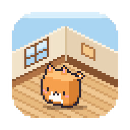
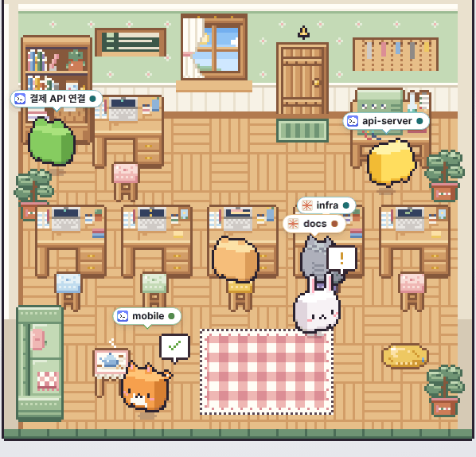
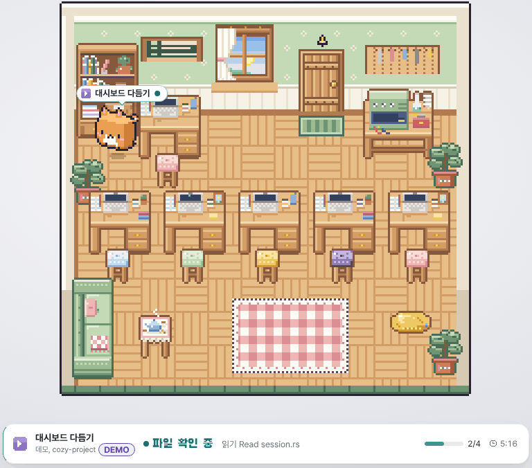
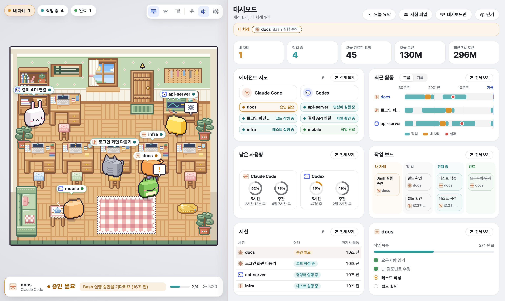
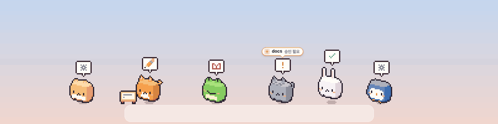
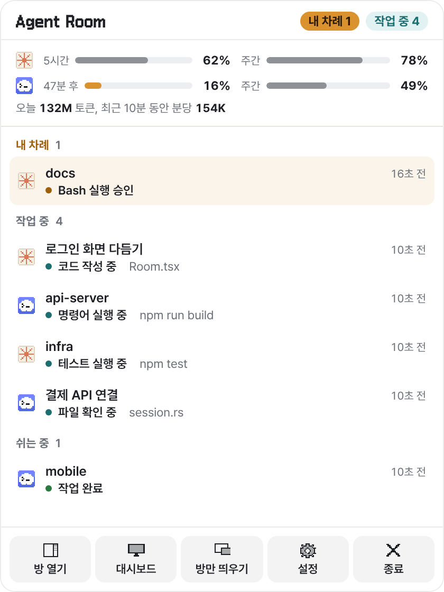
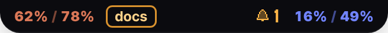
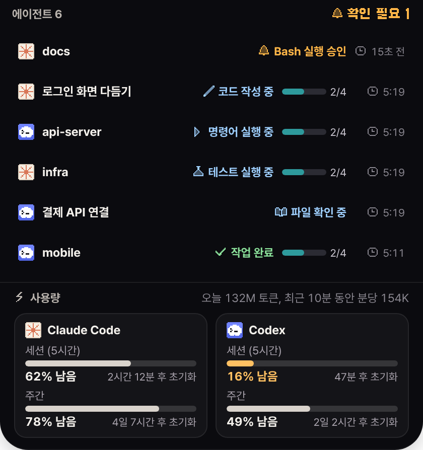

<div align="center">
  

  <h1>Agent Room</h1>
  <p><strong>터미널을 열지 않아도 AI 에이전트가 뭘 하는지 방 안의 펫이 알려 줘요</strong></p>
  <p>Claude Code와 Codex 세션마다 펫 한 마리가 책상에서 일하고,<br>내 승인이 필요하면 앞으로 나와 손을 흔드는 macOS 앱입니다.</p>

  <p>
    
    
    
    
    
  </p>

  <p>
    <a href="#설치"><b>설치하기</b></a>&nbsp;&nbsp;&nbsp;
    <a href="https://github.com/kgyujin/agent-room/releases">릴리스</a>&nbsp;&nbsp;&nbsp;
    <a href="#어떻게-만들었나">어떻게 만들었나</a>
  </p>

  
</div>

> [!NOTE]
> Agent Room은 LLM 토큰을 한 개도 쓰지 않아요. 에이전트가 원래 남기는 Hook 이벤트와 로컬 로그만 읽고, 그 내용을 다시 AI에게 보내지 않습니다.

## 펫은 실제로 일어난 일에 맞춰 움직여요

정해 둔 애니메이션을 반복하는 게 아니라, 에이전트가 지금 하는 일을 그대로 따라 합니다.

| 방에서 보이는 모습 | 그때 에이전트가 하는 일 |
| --- | --- |
| 책장에서 책을 꺼내 읽어요 | 파일을 읽거나 검색하고 있어요 |
| 책상에서 타자를 쳐요 | 코드를 고치고 있어요 |
| 작업대의 장치를 돌려요 | 명령이나 테스트를 실행하고 있어요 |
| 땀을 흘리며 허둥대요 | 테스트가 실패했거나 오류가 났어요 |
| 앞으로 나와 손을 흔들어요 | 내 승인이나 답변을 기다려요 |
| 기뻐한 뒤 차를 마셔요 | 작업을 마치고 쉬고 있어요 |

<p align="center"></p>

## 둘러보기

방 옆에 대시보드를 열면 지금 일하는 에이전트와 최근 활동, 남은 사용량, 세션 목록을 한 화면에서 볼 수 있어요.

<p align="center"></p>

바탕화면 펫을 켜면 펫들이 방 밖으로 나와 Dock 위를 걸어 다녀요. 승인이 필요한 펫은 마우스 쪽으로 달려오고, 누르면 그 세션이 바로 열립니다.

<p align="center"></p>

다른 앱을 쓰고 있을 때는 메뉴 막대나 화면 위쪽의 다이나믹 아일랜드에서 내 차례와 남은 사용량을 확인할 수 있어요.

<table>
  <tr>
    <td align="center" width="50%"></td>
    <td align="center" width="50%"><br><br></td>
  </tr>
</table>

## 이런 것도 할 수 있어요

- 승인이나 답변이 필요할 때, 작업이 끝나거나 실패했을 때 알림을 보내요. 방해 금지 시간에는 조용히 있어요.
- Claude와 Codex 사용량이 5시간 기준과 주간 기준으로 얼마나 남았는지, 언제 다시 채워지는지 보여 줘요. 10% 아래로 내려가면 알려 줍니다.
- 앱보다 먼저 시작한 세션이나 데스크톱 앱에서 연 세션도 로그를 보고 찾아내요.
- Claude Code의 권한 요청을 아일랜드나 대시보드에서 바로 허용하거나 거부할 수 있어요. 이 기능은 설정에서 켜야 해요.
- 색 테마와 펫을 바꿀 수 있고, 직접 그린 PNG를 펫으로 쓸 수도 있어요. 창밖 하늘은 시간에 따라 아침에서 밤으로 바뀝니다.

## 설치

Apple Silicon Mac에 Node.js 18 이상과 git이 있으면 아래 한 줄로 설치할 수 있어요.

```bash
npx github:kgyujin/agent-room
```

앱이 켜지면 안내 카드에서 **연결하기**를 누르세요. 그다음 에이전트 세션을 새로 시작하면 펫이 방에 들어옵니다. 업데이트는 앱이 알아서 확인하고, 지우고 싶을 때는 `npx github:kgyujin/agent-room uninstall`을 실행하면 돼요.

> [!TIP]
> 연결하기 전에 먼저 구경해 보고 싶다면 설정의 고급 탭에서 데모 모드를 켜 보세요.

<details>
<summary>연결하면 무엇이 바뀌나요?</summary>

| 에이전트 | 바뀌는 파일 | 알아 둘 점 |
| --- | --- | --- |
| Claude Code | `~/.claude/settings.json`의 `hooks`와 `statusLine` | 남은 사용량은 Pro와 Max 요금제에서만 보여요 |
| Codex | `~/.codex/hooks.json` | Codex에서 `/hooks`를 열어 한 번 승인해야 해요 |

바꾸기 전에 원래 파일을 `~/.agent-room/backups/`에 백업하고, 쓰던 Hook과 상태줄은 그대로 동작해요. 설정의 고급 탭에서 언제든 Hook을 지우거나 백업으로 되돌릴 수 있어요. 앱만 지워도 Hook은 아무 일도 하지 않고 바로 끝나기 때문에 에이전트는 평소처럼 동작합니다.

</details>

<details>
<summary>.dmg 파일로 직접 설치하기</summary>

[Releases](https://github.com/kgyujin/agent-room/releases)에서 `.dmg`를 받으세요. Apple 공증을 받지 않은 앱이라 처음 열 때는 Finder에서 앱을 우클릭한 뒤 **열기**를 눌러야 해요. 그래도 열리지 않으면 아래 명령을 실행하세요.

```bash
xattr -dr com.apple.quarantine "/Applications/Agent Room.app"
```

</details>

## 개인정보와 안전

Hook은 아무것도 출력하지 않고 항상 성공으로 끝나요. 그래서 에이전트가 하는 일이나 권한 확인 과정에 끼어들지 않습니다. 앱에서 승인하기 기능을 켰을 때만 내가 누른 승인 결과를 에이전트에 전달해요.

프롬프트와 응답, 파일 내용, 명령 출력은 Hook 안에서 바로 버리고, 명령어에 섞인 토큰 값은 가린 뒤 넘겨요. 이벤트는 메모리에만 두며, 앱이 인터넷에 접속하는 경우는 업데이트 확인과 Claude 사용량 확인 두 가지뿐이에요. 둘 다 설정에서 끌 수 있고, 데이터 폴더 `~/.agent-room`은 나만 열 수 있는 권한으로 만들어집니다.

<details>
<summary>어떤 파일을 왜 읽나요?</summary>

| 읽는 곳 | 읽는 내용과 이유 |
| --- | --- |
| `~/.claude/projects`, `~/.codex/sessions` | Hook이 닿지 않는 세션을 찾으려고 파일 이름과 수정 시각, 작업 폴더만 봐요 |
| 세션 대화 로그 | 세션 이름을 붙이려고 `/rename`으로 정한 이름, 요약, 첫 요청의 첫 줄 중 하나만 48자까지 읽어요. 저장하지 않아요 |
| `~/Library/Application Support/Claude/claude-code-sessions` | 데스크톱 앱에서 연 세션을 구분하려고 세션 id와 제목만 읽어요. 키 파일은 열지 않아요 |
| 상태줄 입력, Codex rollout 로그 | 남은 사용량 숫자인 `rate_limits`만 읽어요 |
| `codex app-server` | Codex가 로그에 사용량을 남기지 않을 때 5분마다 한 번 `account/rateLimits/read`로 Codex에 직접 물어봐요. 로그인 정보는 앱이 읽지 않고 Codex가 처리하며, 모델 호출이 아니라 토큰이 들지 않아요 |
| 키체인의 Claude Code 로그인 | 상태줄이 없는 Claude 세션의 사용량을 5분마다 한 번 물어보는 데만 써요. 토큰은 저장하지 않고, 설정에서 끌 수 있어요 |
| `claude` 잠깐 실행 (기본 꺼짐) | '만료된 로그인 자동 갱신'을 켜면, 로그인이 만료됐을 때 보이지 않게 `claude`를 띄워 Claude Code가 직접 로그인을 갱신하게 하고 바로 닫아요. 30분에 한 번까지이고, 아무것도 입력하지 않아요 |

</details>

## 어떻게 만들었나

이 앱에서 가장 중요하게 지킨 원칙은 에이전트를 지켜보는 또 다른 AI가 되지 않는 것이에요. 모든 판단은 에이전트가 이미 남기는 신호로만 하고, 확실하지 않은 건 추측하지 않습니다.

```text
Claude Code, Codex
   │  공식 Hook으로 이벤트 전달
   ▼
agent-room-hook   필요한 값만 남기고, 아무것도 출력하지 않고, 0.3초 안에 끝남
   │  로컬 소켓
   ▼
Agent Room 앱     에이전트별 어댑터 → 공통 이벤트 → 세션 상태 머신 → 방, 아일랜드, 알림
```

Hook은 작은 Rust 바이너리로 만들었어요. 앱이 꺼져 있으면 0.3초 안에 조용히 끝나고, 출력이 없으니 에이전트의 컨텍스트에도 아무것도 더해지지 않아요. 에이전트가 느려지거나 토큰을 더 쓰는 일이 생기지 않게 하려는 선택이었습니다.

Claude Code와 Codex는 Hook 이름도 형식도 달라요. 그래서 에이전트마다 어댑터를 두어 공통 이벤트로 바꾸고, 상태는 하나의 상태 머신이 정하게 했어요. 새로운 에이전트를 지원할 때는 어댑터 하나만 추가하면 됩니다.

모르는 건 모른다고 보여 주는 것도 중요하게 생각했어요. 진행률은 에이전트가 직접 만든 할 일 목록이 있을 때만 보여 주고, 3분 동안 소식이 없으면 상태를 단정하지 않고 응답 없음으로 표시해요.

방과 가구, 펫은 모두 이미지 생성 AI 없이 Python 코드로 한 칸씩 그렸어요. 화면에서는 정수 배율로만 키우기 때문에 도트가 번지지 않습니다. 하루 종일 켜 두는 앱이라 방은 1초에 12번만 그리고, 창이 뒤로 가면 6번으로 줄이고, 창을 숨기면 아예 멈춰요.

| 폴더 | 하는 일 |
| --- | --- |
| `crates/core` | 이벤트 모델, 에이전트 어댑터, 민감정보 필터, 세션 상태 머신, Hook 설치와 제거 |
| `crates/hook` | 에이전트에 등록되는 Hook 바이너리 |
| `app/src-tauri` | 소켓 서버와 메뉴 막대, 아일랜드와 바탕화면 펫 창, 알림을 맡는 Tauri 2 셸 |
| `app/src` | React와 TypeScript로 만든 화면, Canvas 2D 픽셀 렌더러 |
| `tools/art` | 픽셀 아트를 그리는 Python 스크립트 |

<details>
<summary>상태를 정하는 기준</summary>

| 상태 | Claude Code | Codex |
| --- | --- | --- |
| 계획 | `TodoWrite`, Task 도구 | `update_plan` |
| 읽기 | `Read`, `Grep`, `Glob`, `WebFetch` 등 | `read_file`, `list_dir`, `web_search` 등 |
| 코드 작성 | `Edit`, `Write`, `MultiEdit` | `apply_patch` |
| 명령 실행 | `Bash`, MCP, 하위 에이전트 | 셸 명령, MCP |
| 테스트 | `npm test`, `pytest`, `cargo test` 같은 명령 | 같음 |
| 승인이나 답변 필요 | `PermissionRequest`, `Notification`, `AskUserQuestion` | `PermissionRequest` |
| 완료 | `Stop` | `Stop` |
| 오류 | `StopFailure`, `PostToolUseFailure` | 실패한 `PostModelRequest` |

공식 Hook에는 승인했다는 이벤트가 없어서, 승인한 뒤에도 도구가 끝날 때까지 승인 필요 상태가 남아 있을 수 있어요. Codex는 공식 문서를 기준으로 만든 어댑터와 단위 테스트로만 확인했습니다.

</details>

## 개발

Rust stable과 Node 20 이상, Xcode Command Line Tools가 필요해요.

```bash
cd app && npm install
npm run app:dev                  # 개발 모드로 실행
npm run app:build                # .app과 .dmg 만들기
npm run dev                      # 브라우저 미리보기 (http://localhost:1420/?preview=multi)
cargo test -p agent-room-core    # 테스트
```

main 브랜치에 코드가 들어가면 `release` 워크플로가 버전을 올리고 서명된 업데이트를 배포해요.

## 라이선스

MIT 라이선스를 따릅니다. 화면에 쓰는 [Pretendard](https://github.com/orioncactus/pretendard)와 [갈무리](https://github.com/quiple/galmuri) 글꼴은 SIL Open Font License 1.1을 따라요.

<details>
<summary>English</summary>

Agent Room shows what your AI coding agents (Claude Code and OpenAI Codex CLI) are doing as a tiny pixel-art room on macOS. Each session gets a pet at its own desk, and when an agent needs your approval its pet comes forward and waves. It uses no extra LLM tokens because it only reads the agents' official hooks and local logs. Install it with `npx github:kgyujin/agent-room`, then press Connect on the welcome card.

</details>
